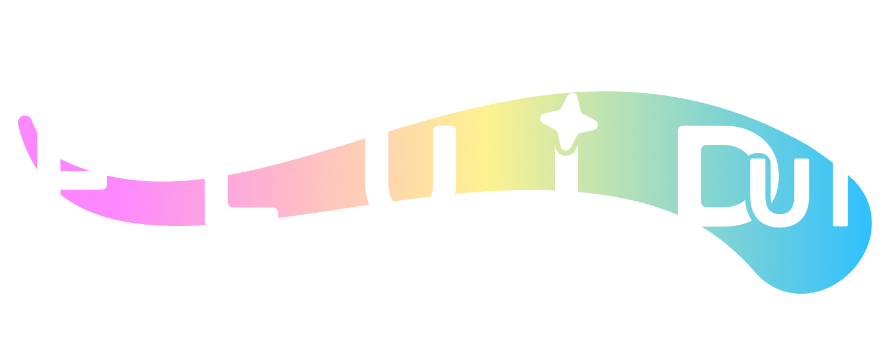

<div align="center" style={}>
    
</div>

<div align="center">
    <a href="#license"></a>
</div>

## Fluid UI is a lightweight, highly customizable UI library for C++ applications, designed to make building beautiful, native interfaces simple and intuitive.

## Project layout and build

Public headers live in `include/FluidUI`, with implementation files in `src/`. The demo and
its theme are in `examples/`, third-party dependencies are in `third_party/`, and Windows
build/install scripts are in `scripts/`. `build/` and `output/` are generated directories.
Run `scripts/build.bat` to build and refresh the runnable package in `output/bin`; the root
`bl.bat` remains as a compatibility entry point.

## Components

`fluid::Context` includes buttons, checkboxes, toggles, radio buttons, float/value sliders,
popup dropdown menus, progress bars, selectable console output and input, file-browser-style
tile containers, text and image labels, image buttons, collapsible containers, containers,
horizontal/vertical lists, tabbed containers, hover hints, timed notifications, and
class-styleable empty widgets.
Text/icon labels can be combined as needed. `InteractiveImage` has its own
`interactive-image` style selector, separate from `image-button`.
Images accept caller-owned `GPUImageId` handles from any rendering API; Fluid UI does not
load, create, or destroy those image resources.
The Windows GLFW example loads PNG and JPEG with WIC and SVG with Direct2D (Windows 10 or
later), then registers the resulting OpenGL textures with the stylesheet.

```cpp
fluid::Context ui;
ui.Style() = fluid::StyleSheet::Dark();

bool enabled = true;
float value = 0.5f;
int selected = 0;
const std::vector<std::string_view> options{"One", "Two", "Three"};

ui.Toggle("Enabled", &enabled);
ui.ValueSlider("Value", &value, 0.0f, 1.0f);
ui.Dropdown("Choice", options, &selected);
ui.ProgressBar("Download", 0.65f);
ui.Image(myGpuImageId, {128.0f, 128.0f});

if (ui.BeginContainer("Panel", {300.0f, 120.0f})) {
    ui.TextLabelLeft("Status", "*");
    ui.EndContainer();
}

ui.PushClass("brand");
ui.EmptyWidget("Brand preview", {360.0f, 120.0f});
ui.PopClass();
```

Call `EndContainer()` for each successful `BeginContainer`, `BeginList`,
`BeginTabContainer`, or `BeginCollapsible`. `BeginList(label, size, true)` creates a
horizontal list; `false` creates a vertical list. `BeginTabContainer` accepts a
`TabPosition::Top`, `Bottom`, or `Left` setting. A `TabItem` with no icon displays text;
one with an icon displays both by default, or just the icon when `showText` is false.
`TileContainer` displays selectable file-style tiles from supplied labels; its optional
GPU-image argument sets a shared tile icon. `ConsoleOutput`
and `ConsoleInput` support mouse text selection; `ConsoleOutput` scrolls when its content
overflows and has a black background by default. It also accepts
`std::vector<Context::ConsoleLine>` entries with `ConsoleTextType::Normal`, `Warning`, or
`Error`; style their colors with the `console-output-normal`, `console-output-warning`, and
`console-output-error` selectors. Retrieve selected bytes with `SelectedConsoleText()` for host
clipboard integration.
The controls also include `TextWrapped`, `TextDisabled`, `InputText`, `DragFloat`/`DragInt`,
`ColorEdit3`/`ColorEdit4`, `Selectable`, `TreeNode`/`TreePop`, and `CollapsingHeader`.
Use `BeginDisabled`/`EndDisabled` to disable a scope, `BeginGroup`/`EndGroup` to keep items
together in layout, and `BeginPropertyGrid`/`EndPropertyGrid` with `PropertyRow` for label/value
rows. `SetNextItemWidth` sets the next widget width, `GetContentRegionAvail` queries remaining
space, `PushWindowPadding`/`PopWindowPadding` overrides window padding, `ClippedList` draws only
visible fixed-height rows, and `ScrollToBottom` moves the current window to its end.
`TreeNode` flags are `TreeNode_Selected`, `TreeNode_Leaf`, and `TreeNode_DefaultOpen`.
Containers automatically show draggable scrollbars when their content exceeds the visible area.
Vertical overflow also responds to the mouse wheel; style container bars with
`container-scrollbar`.
`InputText` receives UTF-8 through `InputState::textInput`; keyboard navigation uses the
`keysDown`/`keysPressed` arrays (GLFW key codes), with legacy backspace/enter/select-all/copy
flags retained. Clipboard integration is provided by `clipboardText` and `setClipboardText`.
The GLFW example wires text input and clipboard events.
Open dropdown popups render above window content; context menus and hints retain their higher
priority layers.
`OpenPopup`/`BeginPopup` and `BeginPopupModal` provide layered popup scopes; pair each
successful begin with `EndPopup`. `BeginPopupContextItem` and `BeginPopupContextWindow` open
right-click popups. Use `BeginDragSource`/`SetDragPayload`/`EndDragSource` and
`BeginDropTarget`/`AcceptDrop`/`EndDropTarget` for typed drag-and-drop data.
`IsItemHovered`, `IsItemClicked`, `IsItemDoubleClicked`, `IsAnyItemActive`,
`IsWindowHovered`, `IsWindowFocused`, `WantsMouse`, `WantsMouseAt`, and `WantsKeyboard`
expose interaction state. `ItemTooltip` shows a tooltip for the last hovered item.
Custom draw helpers include `DrawLine`, `DrawPolyline`, `DrawTriangleFilled`,
`DrawRectFilled`, and `DrawLabel`; `Separator` adds a themed divider.
After an interactive widget, `RMB_Start()` opens its context menu on right-click; add options
with `RMB_Item()` and close the scope with `RMB_End()`. The popup renders above windows,
dock previews, and other UI layers.
The GLFW example includes a dedicated RMB test button with Refresh and Clear console actions.
Call `LMB_Start()` immediately after an interactive widget to detect its left-click
activation, and pair a successful call with `LMB_End()`.
Call `Hint(message)` immediately after an interactive widget to show a tooltip while it is
hovered; hints render above all other UI. `Notification(message)` displays a shadowed toast
at the bottom center of the app for three seconds; a new notification replaces the current
one. The GLFW demo includes
controls for both, and docking a window automatically shows the undocking hint.

## Wrapper-friendly windows and menus

The window/layout subset of common immediate-mode wrappers is available without adding
dependencies on the wrapped application's types:

```cpp
if (ui.Begin("Inspector", &inspectorOpen)) {
    if (ui.BeginChild("Properties", {0.0f, -12.0f})) {
        ui.Text("The child fills the available width and height, leaving 12 px below.");
        ui.EndChild();
    }
    ui.End();
}
```

`Begin(title, open)` creates a centered default-size window; the optional `open` value is
updated when its close control is used. Pair a successful `Begin` with `End`. `BeginChild`
and `EndChild` are aliases for a clipped, padded container. A zero width fills the available
width; a non-positive height uses the remaining content height, minus the absolute value
when negative. The parameterless `SameLine()` places the next item alongside the previous
one.

The main menu bar is drawn at the top of Fluid UI's client area (below the host operating
system's native title bar). It reserves space from dock layouts and supports direct menu
items, nested menus, and popup items:

```cpp
if (ui.BeginMainMenuBar()) {
    if (ui.BeginMenu("File")) {
        if (ui.MenuItem("Open")) { /* open a document */ }
        if (ui.BeginMenu("Recent")) {
            if (ui.MenuItem("Project A")) { /* select a project */ }
            ui.EndMenu();
        }
        ui.EndMenu();
    }
    if (ui.MenuItem("Help")) { /* show help */ }
    ui.EndMainMenuBar();
}
```

Menu visuals can be themed with `main-menu-bar`, `menu`, `menu-popup`, and `menu-item`
CSS selectors. The GLFW demo includes File, Edit, View, Project, and Network menus,
a Settings window, and uses `src/Fonts/OpenSans.ttf` for its text atlas.
Floating windows can be resized from any edge or corner. The dock compass arranges top,
bottom, left, right, and center targets in a 3x3 layout with a live pane preview; docked
windows hide their close control, have no drop shadow,
and require a title-bar double-click to undock. Dragging a docked title bar does not undock
it; drop on another window's title bar to group the windows as tabs. Floating windows retain
their shadows. Visible separators mark the canvas boundary of edge-docked panels for resizing;
window-to-window splitters remain independently draggable. Canvas-boundary separators are drawn
in the adjacent docked panel's layer, so floating windows can cover them. The GLFW demo smooths
rounded geometry with multisampling and higher-resolution corner tessellation, and uses linear
filtering for images; multisampling is kept off for textured draws so it does not add antialiasing
to the text.

## CSS-like themes and classes

Styles can be configured in C++ with `StyleSheet::Rule` or loaded from a CSS-like file.
Selectors support widget names, multiple classes, one ID, grouped selectors, and widget
states (`hover`, `active`, `checked`, `disabled`), for example `button.primary#confirm:hover`.
Use `PushClass`/`PopClass` and `PushStyleID`/`PopStyleID` to apply class and ID selectors to
elements created in those scopes. User rules override the built-in dark theme defaults;
selector specificity still determines precedence between user rules. Global
custom properties can be declared
in `:root`, retained across successive `LoadCSS` calls, and referenced with `var(--name)`
(including a fallback). Colors support 3/4/6/8
digit hex, common named colors, `rgb()`/`rgba()`, `hsl()`/`hsla()`, and `transparent`;
numeric values may include `px`.
Supported properties are `background`, `color`/`foreground`, `accent`, `border-color`,
`shadow-color`, `border-width`, `border-radius` and its `border-radius-top-left`,
`border-radius-top-right`, `border-radius-bottom-left`, and `border-radius-bottom-right`
corner overrides, `font-size`, `width` and `height` (`auto`, pixels, or percentages of the available content
region), `align` (`left`, `center`, `right`, `top`, `middle`, or `bottom`),
`justify-self`, `align-self`, `text-align`, `vertical-align`, `gap`, `shadow-blur`,
`shadow-enabled` (`true` or `false`),
`outline` (`none` or a width, `solid`, and color), `outline-style` (`none` or `solid`),
`outline-color`, `outline-width`,
`opacity`, `transition-speed`, the `border` shorthand, and CSS-style one-to-four-value
`padding`. Outlines and shadows are available to box-drawn components and can be set
using widget selectors or global rules. CSS comments, zero values, and unsupported
properties/selectors are safely ignored or parsed without aborting the stylesheet; malformed
comments or rule blocks fail the load without partially changing the active stylesheet.
Each successful CSS load replaces the previous CSS rules, so removed declarations no longer
remain in effect. Background images are supported with
`background-image: url("...")`,
`background-size` (`stretch`, `cover`, or `contain`), and keyword/percentage
`background-position`. Image URLs resolve to caller-owned GPU resources registered with
`StyleSheet::RegisterImage`; Fluid UI does not load image files itself. Linear gradients
support `linear-gradient(...)` and `gradient(...)` syntax, including angles or
`to right`-style directions,
multiple color stops, and percentage stops. Gradients are accepted anywhere a color is
accepted (backgrounds, foreground/text, accent, borders, outlines, and shadows), including
the `border` and `outline` shorthands. Solid borders and outlines draw only their rings,
so they do not cover the component background. Explicit `background-gradient`,
`text-gradient`, `accent-gradient`, `border-color-gradient`, `outline-color-gradient`,
and `shadow-color-gradient` aliases are also available. Unsupported
declarations are ignored so themes can include properties not implemented by Fluid UI.
`!important` is supported for regular declarations and follows the normal specificity order
among important declarations.
The selector grammar intentionally covers simple selectors rather than combinators, nested
selectors, or media queries. Invalid declarations are ignored.
Window styles also support `window-can-dock` and `window-child-dock`, each accepting
`true` or `false`.
In the GLFW demo, use `Layout > Theme > Theme settings` to select a CSS file, reload the
active file, or toggle automatic reload. Invalid CSS leaves the last successfully loaded
theme active and reports the error in the theme window.

```css
button.primary {
    background: #3559D8;
    border-radius: 8px;
    padding: 7px 14px;
}

button.primary:hover {
    background: #4A6CF7;
}

button#confirm {
    width: 180px;
    text-align: center;
}

interactive-image:hover {
    background: #304762;
}

empty-widget.brand {
    background: linear-gradient(120deg, #101319, #1D2B42);
    background-image: url("../src/Images/Icon.jpg");
    background-size: contain;
    background-position: center;
}

empty-widget.gradient-demo {
    background: linear-gradient(110deg, #213A67 0%, #3978B8 52%, #8A5CE6 100%);
}

text.gradient-text {
    text-gradient: linear-gradient(90deg, #62D5FF, #A991FF, #FF86C8);
}

window-title {
    background: #1A2637;
    color: #F1F5FC;
    padding: 7px 12px;
}

window.no-docking {
    window-can-dock: false;
}

window.no-children {
    window-child-dock: false;
}
```

```cpp
std::string error;
if (!ui.Style().LoadCSSFile("ui.css", &error)) {
    // Handle the reported file or syntax error.
}

ui.PushClass("primary");
ui.Button("Save");
ui.PopClass();

ui.Style().RegisterImage("../src/Images/Icon.jpg", myGpuImageId, {1024.0f, 1024.0f});
```

`EmptyWidget(id, size)` reserves and paints a class-styleable region without drawing
content. `ImageWidget(id, imageId, size)` draws a class-styleable framed image with CSS
padding, fit, position, background, border, and shadow styles. The GLFW demo loads
`src/Images/Icon.jpg`, registers it for its CSS background-image URL, and displays it in
both an empty widget and an image widget near the top of the component window. The registered
source must match the `url(...)` value in CSS. The demo also shows gradients on backgrounds,
text, borders, and accent colors.

The `examples` target includes `theme.css` and a GLFW demo covering the controls, container
layouts, all tab positions, image widgets, dropdown variants, CSS classes, and collapsible
content.

### Rendering API image IDs

Use a nonzero `fluid::GPUImageId` for a GPU image that your application loaded or created.
The image is sampled with the full `[0, 1]` UV range. `ImageLabel` and `ImageButton` accept
the same ID and an explicit display size. The UI never takes ownership of that resource.
`TextLabelLeft` and `TextLabelRight` also accept an image ID and display size for image
icons; the existing text-icon overloads remain available.

```cpp
// OpenGL texture name:
fluid::GPUImageId imageId = static_cast<fluid::GPUImageId>(glTexture);
ui.Image(imageId, {256.0f, 128.0f});
ui.ImageLabel("Preview", imageId, {64.0f, 64.0f});
if (ui.ImageButton("Use preview", imageId, {32.0f, 32.0f})) { /* ... */ }
```

The renderer consumes `DrawCmd::texture` and binds/resolves that ID in its own API. With
OpenGL, bind the texture name; with Vulkan or another descriptor-based API, use a stable
nonzero ID registered in your renderer and map it to the appropriate image view and sampler.
ID `0` is reserved for untextured geometry. Keep externally supplied images alive until the
draw list using them has been rendered.

## Windows and dynamic docking

Window titles are centered in the title bar; the right-side close control hides the window.
Click a window to focus and bring it above the other windows. Drag the bottom-right corner
to resize it. Closed windows can be restored with
`Context::SetWindowOpen("Window title", true)`. Long content scrolls vertically with the
mouse wheel or by dragging the scrollbar.

Hold a window's title bar to show the docking compass. Hover its left, right, top, bottom,
or center target to preview that layout, then release to dock. Docked windows tile without
overlapping; adding panels on other edges adjusts the available regions. Drag the boundary
splitters to resize edge regions horizontally or vertically, or drag dividers between
same-edge panels to resize individual windows. Dropping on the compass center stacks windows
as selectable tabs in the center dock area. Click a tab to switch windows. Dropping on any
part of an eligible window groups the dragged window as a tab. This works between floating
and docked windows, and preserves the target's dock region. Dragging a grouped title bar keeps
the group intact; double-click a docked title bar to undock it. Docked window corners are
square, and the dock compass takes precedence over windows behind it. Drop a floating
window on the compass center to add it to the center dock tab group. The layout
adapts when the display changes size. Use `Context::DockWindows(false)` to disable docking.
CSS `window-can-dock: false` prevents a window from being docked, and
`window-child-dock: false` prevents other windows from being grouped into it; both properties
apply to `window` styles and default to `true`.
The `dock-highlight` selector's `color` sets the outline color shown across the full target
window while dragging another window onto it.

Save and restore window positions, sizes, open state, dock sides, dock order, split
proportions, and focus with `Context::SaveLayout` and `Context::LoadLayout`. Layout files
are versioned and validated before being applied; tab groups and the selected center dock tab
are saved too. Version 1 layouts are still accepted, and older tab groups whose original anchor
was removed are normalized when loaded. Keep window titles and any surrounding
`PushID` scopes stable between runs so saved window IDs continue to identify the same windows.

The demo loads its layout at startup and saves it when the application exits. By default,
the file is `fluidui-layout.ini` in the current working directory. Change the path with
the `--layout` command-line option, for example:

```text
basic_glfw_gl.exe --layout "C:\Users\me\AppData\Roaming\MyApp\layout.ini"
```

Applications can choose any path by passing it to `SaveLayout(path)` and
`LoadLayout(path)`; both methods report errors through their optional error string.
